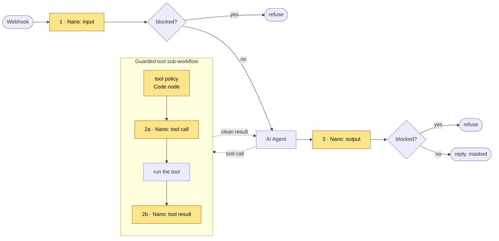

# Guarding an n8n AI agent

Two importable workflows that put guardrails around n8n's **AI Agent** node: an API check on every incoming message and every reply, and a **guarded tool** sub-workflow that every tool goes through. No code to write: import, add two credentials, done.

## The workflows

| File | What it does |
|---|---|
| [`guarded-support-agent.json`](guarded-support-agent.json) | Webhook → **1 · input check** → AI Agent → **3 · output check** → reply. Every tool of the agent is a call to the guarded-tool workflow. |
| [`guarded-tool.json`](guarded-tool.json) | One guarded tool call: **tool policy** (Code node) → **2a · tool-call check** → run the tool → **2b · tool-result check** → clean result back to the agent. |



## Set up (5 minutes)

1. In n8n: **Workflows → Import from file** → `guarded-tool.json`, then `guarded-support-agent.json`.
2. Create an **HTTP Header Auth** credential named **ProofAgent Nano**: name `Authorization`, value `Bearer pa_nano_…` (get a free key at [app.proofagent.ai](https://app.proofagent.ai)). Select it on every Nano node.
3. Add your **OpenAI** credential to the *Chat model* node (or swap in any chat model node).
4. In the agent workflow, open each **Tool: …** node and select the *Guarded tool* workflow.
5. In *Guarded tool*, replace the **Run the tool** node with your real tool (HTTP Request, Gmail, Postgres…).
6. Activate, then `POST {"message": "…"}` to the webhook URL.

## Why a sub-workflow for tools?

n8n's AI Agent node has no "before tool" or "after tool" hook. Wrapping each tool in one shared sub-workflow gives you both, enforced: the agent can only reach a tool **through** the checks. The tool policy Code node carries the same rules as `shared/agent/tools.json` (known tools, valid order ids, email only inside the allowlist).

**MCP option:** n8n's MCP Client Tool node can give the agent Nano's `check_*` tools. That is advisory (the model decides whether to call them), so keep the API checks above as the enforced layer.

## Tested

```bash
python test_workflow.py
```

- **Structure:** both workflows are valid; every connection points to a real node; every Nano node posts `text` and `direction` to `/v1/scan` with the credential; every tool in `tools.json` is wired as a guarded tool.
- **Behaviour:** all 9 scenarios run through the workflows' **own JavaScript** (the Code node and every `{{ }}` expression, executed in JavaScriptCore) against a local Nano-compatible `/v1/scan`. All pass. On Linux the behaviour part is skipped (no `osascript`).
- **Not yet tested:** importing into a running n8n instance (the build machine has no Node.js). If a node shows a warning after import, re-select its credential or workflow; the node versions used are Webhook 2, HTTP Request 4.2, IF 2, Code 2, Set 3.4, AI Agent 1.7, Call n8n Workflow Tool 2.
